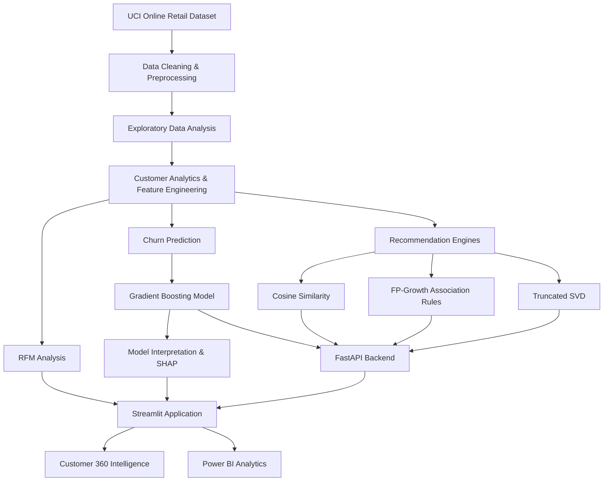

# 🛍️ Commerce Customer Intelligence

### An End-to-End E-Commerce Analytics, Machine Learning & Recommendation Platform

An end-to-end Data Science and Machine Learning platform that transforms historical e-commerce transactions into actionable customer intelligence through customer segmentation, churn prediction, explainable AI, and personalized product recommendations.

<p align="center">
  
  
  
  
  
</p>

<p align="center">
  <a href="https://github.com/nikunjpanthi5/Commerce-Customer-Intelligence">Repository</a> ·
  <a href="https://nikunjapanthi.com.np/">Developer Portfolio</a> ·
  <a href="https://archive.ics.uci.edu/dataset/352/online+retail">Dataset Source</a>
</p>

---

## 📌 Table of Contents

- [Overview](#-overview)
- [Project Objectives](#-project-objectives)
- [Key Features](#-key-features)
- [System Architecture](#-system-architecture)
- [Machine Learning Methodology](#-machine-learning-methodology)
- [Model Evaluation](#-model-evaluation)
- [Recommendation Systems](#-recommendation-systems)
- [Technology Stack](#-technology-stack)
- [Dataset](#-dataset)
- [Repository Structure](#-repository-structure)
- [Getting Started](#-getting-started)
- [API Documentation](#-api-documentation)
- [Future Improvements](#-future-improvements)
- [Author](#-author)

---

## 🎯 Overview

E-commerce businesses generate large volumes of transactional data, but extracting meaningful customer-level insights requires more than traditional sales reporting.

**Commerce Customer Intelligence** explores how data science and machine learning can transform transaction histories into customer-level intelligence.

The platform integrates:

- Exploratory Data Analysis and customer analytics.
- RFM-based customer segmentation.
- Customer churn prediction.
- Feature engineering and model evaluation.
- SHAP-based model interpretation.
- Multiple product recommendation approaches.
- FastAPI-based machine learning services.
- Streamlit-based interactive dashboards.
- Power BI business intelligence.

The objective is to demonstrate how different analytical and machine learning techniques can work together in an integrated customer intelligence platform.

## 🎯 Project Objectives

1. Understand customer purchasing behaviour through exploratory analysis.
2. Develop customer-level features using RFM analysis and feature engineering.
3. Identify customers with an increased likelihood of churn.
4. Evaluate machine learning models using appropriate classification metrics.
5. Interpret model predictions and investigate important customer-level risk factors.
6. Explore multiple product recommendation approaches.
7. Expose trained models through REST APIs.
8. Present customer intelligence through interactive dashboards and business analytics.

---

## ✨ Key Features

### 1. Customer Analytics & Feature Engineering

- Transaction data cleaning and preprocessing.
- Exploratory Data Analysis.
- Customer-level aggregation.
- Recency, Frequency and Monetary (RFM) analysis.
- Customer purchasing behaviour analysis.
- Customer value and activity segmentation.
- Extended behavioural feature engineering.

### 2. Customer Churn Prediction

A supervised machine learning pipeline designed to estimate customer churn risk from historical purchasing behaviour.

The modelling workflow includes:

- Data preparation and leakage-aware feature selection.
- Model comparison and experimentation.
- Gradient Boosting classification.
- Hyperparameter tuning.
- Classification threshold analysis.
- ROC-AUC evaluation.
- Confusion matrix and classification metrics.
- SHAP-based model interpretation.

**Customer-level prediction outputs:**

- Predicted churn probability.
- Churn classification.
- Customer risk categorization.
- Retention-oriented analytical insights.

### 3. Three Product Recommendation Engines

The platform explores three different recommendation approaches.

| Recommendation engine | Algorithm | Purpose |
|---|---|---|
| Item-to-item recommendation | Cosine Similarity | Find products similar to a selected product |
| Association-based recommendation | FP-Growth and Association Rules | Discover product associations and cross-selling opportunities |
| Personalized recommendation | Truncated SVD | Generate personalized product recommendations |

These approaches demonstrate different ways of extracting recommendation signals from historical purchasing behaviour.

### 4. Customer 360 Intelligence Dashboard

An interactive Streamlit application bringing customer analytics and machine learning outputs together.

**Dashboard modules:**

- Executive Summary
- Customer 360 & AI Intelligence
- AI Churn Prediction
- Personalized Product Recommendations
- Customer Behavioural Profile
- Purchase History
- Power BI Analytics Hub
- Static Dashboard Gallery

### 5. FastAPI Backend

A REST API designed to serve trained machine learning models and recommendation engines.

| Method | Endpoint | Purpose |
|---|---|---|
| GET | `/` | API status |
| GET | `/health` | Service and model health |
| POST | `/predict/churn` | Predict customer churn |
| POST | `/recommend/similar-items` | Find similar products |
| POST | `/recommend/cart-bundles` | Generate cross-selling suggestions |
| POST | `/recommend/user-feed` | Generate personalized recommendations |

Interactive API documentation is available through FastAPI Swagger UI.

### 6. Business Intelligence

Power BI integration and interactive visualizations provide additional perspectives on:

- Customer behaviour.
- Sales performance.
- Revenue trends.
- Product performance.
- Business patterns.

---

## 🏗️ System Architecture

The platform combines data processing, machine learning, recommendation engines, an API backend, and interactive analytics.



---

## 🧠 Machine Learning Methodology

### Customer Feature Engineering

Customer-level features are developed from transaction histories.

Examples include:

- Recency
- Frequency
- Monetary value
- Average days between orders
- Customer tenure
- Unique products purchased
- Total units purchased
- Average order value
- Average basket size
- Spending variability
- Maximum order value

### Churn Prediction

The churn prediction workflow uses customer-level behavioural features and a dynamically defined churn target.

The modelling process includes:

1. Target construction.
2. Leakage inspection and feature selection.
3. Data preparation.
4. Model experimentation.
5. Hyperparameter tuning.
6. Probability threshold analysis.
7. Performance evaluation.
8. Model interpretation.

### Model Interpretation

SHAP is used to investigate feature contributions to model predictions.

This supports analysis of:

- Global feature importance.
- Individual customer predictions.
- Factors associated with higher predicted churn risk.

---

## 📊 Model Evaluation

The current Gradient Boosting experiments produced the following reported results.

### Model performance

| Experiment | Validation ROC-AUC |
|---|---:|
| Baseline Gradient Boosting | 0.8943 |
| Tuned Gradient Boosting | 0.8931 |

The tuned experiment did not improve ROC-AUC over the baseline in the reported validation results.

### Classification threshold analysis

At a classification threshold of **0.35**, the reported results were:

| Metric | Result |
|---|---:|
| Accuracy | 87.21% |
| Precision | 92.43% |
| Recall | 63.81% |
| F1-score | 0.7550 |

The threshold is selected as part of the classification analysis rather than assuming that 0.50 is automatically optimal.

**Important:** These are project-reported validation results, not a guarantee of performance on future or external datasets.

---

## 🛍️ Recommendation Systems

Three recommendation approaches are implemented and explored.

### Item-to-item Cosine Similarity

Uses product purchase patterns to calculate similarity between items and identify related products.

### FP-Growth and Association Rules

Identifies frequent itemsets and product associations.

Current experimentation includes:

- Minimum support: 0.02
- Minimum lift: greater than 1.2

### Personalized Recommendations using Truncated SVD

Uses matrix factorization to explore personalized recommendations from customer-product interaction patterns.

Current configuration uses 20 latent components.

---

## 🧰 Technology Stack

| Category | Technologies |
|---|---|
| Programming | Python |
| Data Manipulation | Pandas, NumPy |
| Visualization | Matplotlib, Seaborn, Plotly |
| Machine Learning | Scikit-learn |
| Recommendation Systems | Cosine Similarity, FP-Growth, Association Rules, Truncated SVD |
| Model Interpretation | SHAP |
| Model Persistence | Joblib |
| Backend | FastAPI, Pydantic |
| Frontend | Streamlit |
| Business Intelligence | Microsoft Power BI |
| Development | Jupyter Notebook, Git, GitHub |

---

## 📂 Repository Structure

The current repository keeps its Jupyter notebooks in the root directory.

```text
Commerce-Customer-Intelligence/
│
├── api/
│   └── main.py
│
├── dashboard/
│
├── data/
│
├── models/
│
├── reports/
│   └── figures/
│
├── 01_understanding_data.ipynb
├── 02_EDA.ipynb
├── 03_churn_prediction.ipynb
├── 03_feature_enginerring.ipynb
├── 04_Product_recommendation.ipynb
│
├── app.py
├── .gitattributes
├── .gitignore
└── README.md
```

The `data`, `models`, and `dashboard` directories contain supporting project resources. Their detailed contents depend on the files included in the repository.

---

## 📊 Dataset

This project uses the **Online Retail dataset** from the UCI Machine Learning Repository.

**Dataset source:**  
https://archive.ics.uci.edu/dataset/352/online+retail

The dataset contains historical transactions from a UK-based online retail business covering December 2010 to December 2011.

### Dataset characteristics

- Invoice and transaction identifiers.
- Product descriptions.
- Customer identifiers.
- Purchase quantities.
- Unit prices.
- Invoice timestamps.
- Transaction-level purchasing information.

**Currency:** British Pound Sterling (GBP).

The transaction data is processed and transformed into customer-level analytical features for modelling and recommendation tasks.

Please obtain the dataset from its original source and follow its applicable usage and redistribution conditions.

---

## 🚀 Getting Started

### Prerequisites

- Python 3.10 or later.
- Git.
- Jupyter Notebook or JupyterLab.
- Access to the required processed datasets and trained model artifacts.

### 1. Clone the repository

```bash
git clone https://github.com/nikunjpanthi5/Commerce-Customer-Intelligence.git

cd Commerce-Customer-Intelligence
```

### 2. Create a virtual environment

**Windows**

```bash
python -m venv .venv

.venv\Scripts\activate
```

**Linux / macOS**

```bash
python3 -m venv .venv

source .venv/bin/activate
```

### 3. Install dependencies

```bash
python -m pip install --upgrade pip

pip install pandas numpy scipy scikit-learn
pip install matplotlib seaborn plotly
pip install streamlit fastapi uvicorn pydantic
pip install joblib requests mlxtend shap
```

### 4. Prepare project resources

Ensure the required processed datasets and trained model artifacts are available in the expected project locations.

The application requires its corresponding data and model files. Cloning the repository does not automatically download external datasets or train the models.

### 5. Start the FastAPI backend

From the project root:

```bash
uvicorn api.main:app --reload --port 8000
```

API documentation:

```text
http://127.0.0.1:8000/docs
```

### 6. Start the Streamlit application

Open another terminal, activate the same virtual environment, and run:

```bash
streamlit run app.py
```

The application should be available at:

```text
http://localhost:8501
```

**Note:** The application may require configuration of local data paths, model artifact paths, and the backend URL. Ensure these match your local environment and the application's configuration.

---

## 🔮 Future Improvements

Potential areas for further development include:

- Temporal validation of churn predictions.
- More extensive model comparison and hyperparameter optimization.
- Recommendation evaluation using Precision@K, Recall@K, MAP@K, and NDCG@K.
- Cold-start recommendation strategies.
- Content-based recommendation integration.
- Automated model retraining pipelines.
- Model monitoring and performance tracking.
- API authentication and security.
- Cloud deployment and scalability improvements.
- A/B testing of customer retention strategies.

---

## 👨‍💻 Author

**Nikunja Panthi (Nikunj Panthi)**

BIT Student | Data Science | Machine Learning | AI Research Enthusiast

- **GitHub:** https://github.com/nikunjapanthi5
- **LinkedIn:** https://www.linkedin.com/in/nikunja-panthi-47107a294/
- **Portfolio:** https://nikunjapanthi.com.np/

📍 Pokhara, Nepal

---

<p align="center">
  <i>Turning E-Commerce Transactions into Customer Intelligence.</i>
</p>
