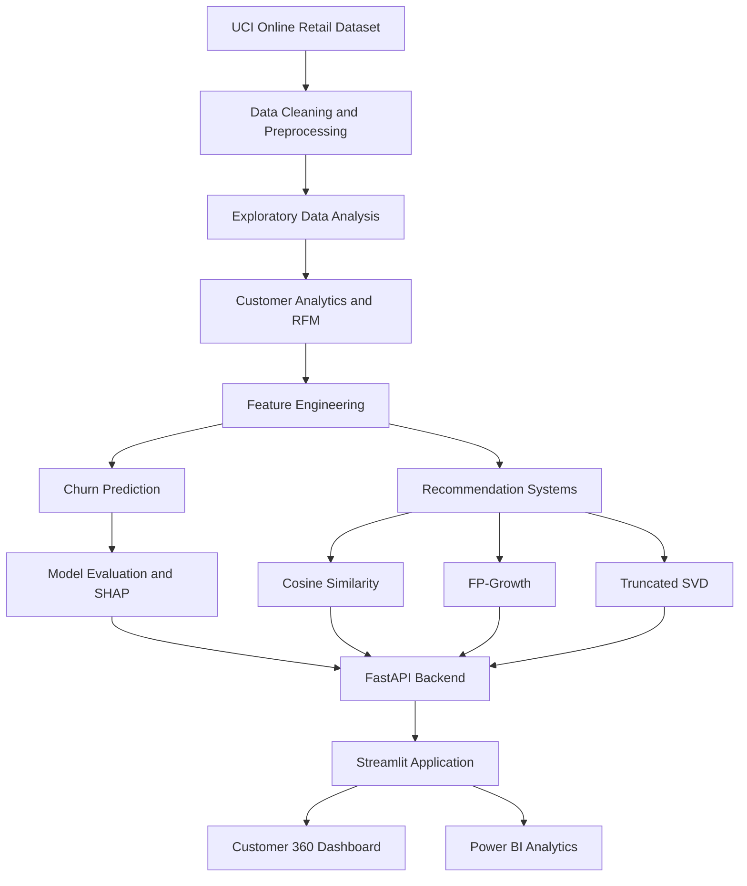

# 🛍️ Commerce Customer Intelligence

**An end-to-end Data Science and Machine Learning platform for e-commerce customer analytics, churn prediction, explainable AI, and personalized product recommendations.**

<p align="center">
  
  
  
  
  
  
</p>

---

## 📌 Overview

Commerce Customer Intelligence transforms historical e-commerce transaction data into actionable customer insights using data analytics, machine learning, recommendation algorithms, and business intelligence.

The project explores how historical purchasing behaviour can be used to:

- Understand customer purchasing patterns.
- Segment customers using RFM analysis.
- Identify customers with a higher likelihood of churn.
- Explain machine learning predictions using SHAP.
- Recommend similar products and complementary items.
- Generate personalized product recommendations.
- Present customer intelligence through interactive dashboards and REST APIs.

The platform brings together the complete workflow, from transaction-level data processing to predictive modelling and application-level integration.

## 🎯 Project Objectives

1. Perform data cleaning, preprocessing, and exploratory data analysis.
2. Develop customer-level behavioural features using RFM analysis and feature engineering.
3. Build and evaluate machine learning models for churn prediction.
4. Investigate model performance using classification metrics and ROC-AUC.
5. Interpret model predictions using explainable AI techniques.
6. Implement multiple product recommendation approaches.
7. Integrate trained models into a FastAPI backend.
8. Develop an interactive Streamlit customer intelligence application.
9. Present business insights through Power BI.

---

## 📸 Project Screenshots

The following screenshots showcase the application's interface, customer analytics, machine learning predictions, and recommendation capabilities.

<!-- PROJECT-GALLERY:START -->


<!-- PROJECT-GALLERY:END -->

---

## ✨ Key Features

### 1. Data Analytics and Feature Engineering

The data analytics workflow focuses on transforming raw transaction records into meaningful customer-level information.

**Implemented activities:**

- Data cleaning and preprocessing.
- Exploratory Data Analysis (EDA).
- Customer-level transaction aggregation.
- Recency, Frequency, and Monetary (RFM) analysis.
- Extended customer behavioural feature engineering.
- Purchasing pattern and revenue analysis.
- Customer activity and value analysis.

**Examples of engineered features:**

- Recency
- Frequency
- Monetary
- Average Days Between Orders
- Customer Tenure
- Unique Products
- Total Units
- Units per Order
- Average Order Value
- Average Basket Size
- Spending Variability
- Maximum Order Value

### 2. Customer Churn Prediction

A supervised machine learning pipeline designed to estimate customer churn risk from historical purchasing behaviour.

The project explores model development, comparison, evaluation, and interpretation.

**Implemented workflow:**

- Customer-level feature preparation.
- Churn target construction.
- Leakage-aware feature selection.
- Model experimentation.
- Gradient Boosting classification.
- Hyperparameter tuning.
- Classification threshold analysis.
- Model evaluation.
- ROC-AUC analysis.
- SHAP-based model interpretation.

**Customer-level prediction outputs:**

- Predicted churn probability.
- Churn classification.
- Customer risk category.
- Important contributing features.
- Potential retention insights.

#### Churn Risk Categories

| Risk category | Predicted probability |
|---|---:|
| Low | Below 0.20 |
| Medium | 0.20 to below 0.35 |
| High | 0.35 or above |

These categories provide a practical way to organize customers according to their estimated churn risk.

### 3. Model Performance and Evaluation

Gradient Boosting was evaluated using validation data, with both baseline and tuned results considered.

#### Reported results

| Evaluation | ROC-AUC |
|---|---:|
| Baseline Gradient Boosting | 0.8943 |
| Tuned Gradient Boosting | 0.8931 |

The baseline model achieved a slightly higher ROC-AUC than the tuned version. Hyperparameter tuning therefore did not improve this particular validation result.

#### Classification performance at threshold 0.35

| Metric | Result |
|---|---:|
| Accuracy | 87.21% |
| Precision | 92.43% |
| Recall | 63.81% |
| F1-score | 0.7550 |

The threshold of 0.35 represents an operating point selected for classification analysis. Threshold selection involves balancing precision and recall according to the intended business use.

**Evaluation and explainability materials**

Additional technical visualizations are maintained in the repository's `reports/` directory, including model evaluation and interpretability outputs.

Examples of analysis include:

- ROC curves and ROC-AUC.
- Confusion matrices.
- SHAP feature importance and summary plots.
- Gini-related evaluation.
- Classification performance comparisons.

See the [`reports/`](reports/) directory for available materials.

### 4. Explainable AI with SHAP

Model interpretation is important because churn predictions should provide more than just a probability.

SHAP is used to investigate how input features contribute to model predictions.

The analysis helps examine:

- Which features influence predictions globally.
- How individual features affect predicted churn risk.
- Why a particular customer receives a higher or lower risk score.
- Which behavioural patterns may be associated with churn.

This supports more interpretable and actionable customer analytics.

### 5. Three Product Recommendation Engines

The project implements three recommendation approaches based on historical purchasing behaviour.

| Recommendation engine | Algorithm | Purpose |
|---|---|---|
| Item-to-item recommendation | Cosine Similarity | Find products similar to a selected product |
| Cart bundle recommendation | FP-Growth and Association Rules | Identify products frequently purchased together |
| Personalized recommendation | Truncated SVD | Generate personalized product recommendations |

**Implementation details:**

- Item-item similarity using cosine similarity.
- Association rule mining using FP-Growth.
- Minimum support: 0.02.
- Association rules filtered using lift greater than 1.2.
- Truncated SVD with 20 components.

These approaches demonstrate different ways of extracting recommendation signals from transaction history.

### 6. Customer 360 Intelligence Dashboard

An interactive Streamlit application brings customer analytics, predictive modelling, and recommendation outputs together.

**Dashboard modules include:**

- Executive Summary.
- Customer 360 & AI Intelligence.
- AI Churn Prediction.
- Personalized Product Recommendations.
- Customer Behavioural Profile.
- Purchase History.
- Power BI Analytics Hub.
- Static Dashboard Gallery.

The application is designed to make analytical outputs accessible through an interactive interface.

### 7. FastAPI Backend

A FastAPI backend exposes the trained machine learning models and recommendation engines through REST API endpoints.

| Method | Endpoint | Purpose |
|---|---|---|
| GET | `/` | API status |
| GET | `/health` | Model and service health |
| POST | `/predict/churn` | Predict customer churn |
| POST | `/recommend/similar-items` | Find similar products |
| POST | `/recommend/cart-bundles` | Generate product bundle suggestions |
| POST | `/recommend/user-feed` | Generate personalized recommendations |

Interactive API documentation is available through FastAPI Swagger UI at `/docs` when the backend is running.

### 8. Business Intelligence with Power BI

Power BI integration provides additional business-oriented visualizations.

The analytics component supports exploration of:

- Sales performance.
- Customer purchasing behaviour.
- Revenue trends.
- Product performance.
- Business-level insights.

---

## 🏗️ System Architecture

The project follows a modular architecture that connects data processing, machine learning, recommendation systems, API services, and dashboard components.



---

## 🧰 Technology Stack

| Category | Technologies |
|---|---|
| Programming | Python |
| Data Manipulation | Pandas, NumPy |
| Scientific Computing | SciPy |
| Visualization | Matplotlib, Seaborn, Plotly |
| Machine Learning | Scikit-learn |
| Recommendation Systems | Cosine Similarity, FP-Growth, Association Rules, Truncated SVD |
| Explainable AI | SHAP |
| Model Persistence | Joblib |
| Backend | FastAPI, Pydantic |
| Frontend | Streamlit |
| Business Intelligence | Microsoft Power BI |
| Development | Jupyter Notebook, Git, GitHub |

---

## 📂 Project Structure

```text
Commerce-Customer-Intelligence/
│
├── api/
│   └── main.py
│
├── dashboard/
│
├── data/
│   ├── raw/
│   └── processed/
│
├── models/
│
├── reports/
│   └── figures/
│
├── Project Snapshot/
│
├── 01_understanding_data.ipynb
├── 02_EDA.ipynb
├── 03_churn_prediction.ipynb
├── 03_feature_enginerring.ipynb
├── 04_Product_recommendation.ipynb
│
├── app.py
├── .gitattributes
├── .gitignore
└── README.md
```

The repository keeps its Jupyter notebooks in the root directory. The existing directory organization is retained.

---

## 📊 Dataset

This project uses the **Online Retail dataset** from the UCI Machine Learning Repository.

**Dataset source:** [UCI Machine Learning Repository – Online Retail](https://archive.ics.uci.edu/dataset/352/online+retail)

The dataset contains historical transactions from a UK-based online retail business covering December 2010 to December 2011.

**Dataset information includes:**

- Invoice and transaction identifiers.
- Product descriptions.
- Customer identifiers.
- Purchase quantities.
- Unit prices.
- Invoice timestamps.
- Transaction-level purchasing information.

**Currency:** British Pound Sterling (GBP).

The transaction data is transformed into customer-level analytical features for churn modelling and recommendation tasks.

The dataset does not provide a ready-made customer churn label. The project constructs a churn target from customer purchasing inactivity. The modelling workflow therefore requires careful target definition and leakage-aware feature preparation.

---

## 🚀 Getting Started

### 1. Clone the repository

```bash
git clone https://github.com/nikunjpanthi5/Commerce-Customer-Intelligence.git

cd Commerce-Customer-Intelligence
```

### 2. Download Git LFS files

If you use the repository's Git LFS-managed model or data artifacts:

```bash
git lfs install
git lfs pull
```

### 3. Create a virtual environment

**Windows:**

```bash
python -m venv venv
venv\Scripts\activate
```

**Linux / macOS:**

```bash
python -m venv venv
source venv/bin/activate
```

### 4. Install dependencies

```bash
python -m pip install --upgrade pip

pip install pandas numpy scipy scikit-learn
pip install matplotlib seaborn plotly
pip install streamlit fastapi uvicorn pydantic
pip install joblib requests mlxtend shap
```

These commands install the main packages used by the documented workflows. Additional packages may be required depending on the imports and components in the current application.

### 5. Prepare data and model artifacts

Ensure the required processed datasets and trained model artifacts are available.

The application depends on the corresponding data and model files. Check the paths configured in the application and API code and adjust them for your local environment where necessary.

**Note:** Running the application does not automatically train the models.

### 6. Start the FastAPI backend

From the repository root:

```bash
uvicorn api.main:app --reload --port 8000
```

API base URL:

```text
http://127.0.0.1:8000
```

Swagger documentation:

```text
http://127.0.0.1:8000/docs
```

### 7. Start the Streamlit application

Open another terminal, activate the same virtual environment, and run:

```bash
streamlit run app.py
```

The application should be available at:

```text
http://localhost:8501
```

---

## 🧠 Machine Learning and Data Science Concepts

This project explores several practical concepts:

- Exploratory Data Analysis.
- Customer segmentation.
- RFM analysis.
- Behavioural feature engineering.
- Supervised classification.
- Ensemble learning.
- Hyperparameter optimization.
- Classification threshold selection.
- Model evaluation and validation.
- Explainable AI.
- Item-based recommendation.
- Association rule mining.
- Matrix factorization.
- REST API integration.
- Business-oriented customer analytics.

---

## 🔮 Future Improvements

Potential areas for further development include:

- More extensive model comparison and hyperparameter optimization.
- Temporal validation of churn predictions.
- Further investigation of model calibration.
- Recommendation evaluation using Precision@K, Recall@K, MAP@K, and NDCG@K.
- Cold-start recommendation strategies.
- Content-based recommendation integration.
- Automated model retraining pipelines.
- Model monitoring and performance tracking.
- Authentication and API security.
- Cloud deployment and scalability improvements.
- A/B testing of customer retention strategies.

---

## 👨‍💻 Author

**Nikunja (Nikunj) Panthi**

BIT Student | Data Science | Machine Learning | AI Research

- **GitHub:** [@nikunjpanthi5](https://github.com/nikunjpanthi5)
- **LinkedIn:** [Nikunja Panthi](https://www.linkedin.com/in/nikunja-panthi-47107a294/)
- **Portfolio:** [nikunjapanthi.com.np](https://nikunjapanthi.com.np/)

---

<p align="center">
  <b>Turning E-Commerce Transactions into Customer Intelligence.</b>
</p>
